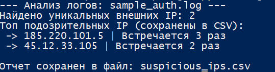

# 🐍 Python SOC Tools

Коллекция скриптов на Python для автоматизации рутинных задач аналитика SOC L1.

## 📜 Скрипт `log_analyzer.py`

**Задача:** Автоматизация первичного Triage логов для выявления признаков брутфорса (Brute-force) и подозрительной сетевой активности.

**Основной функционал:**
*   Извлекает все IPv4-адреса из текстового файла логов с помощью регулярных выражений (RegEx).
*   **Отсеивает локальные (серые) IP-адреса** и `localhost`, используя библиотеку `ipaddress`, чтобы аналитик не отвлекался на внутренний шум.
*   Подсчитывает частоту вхождения каждого внешнего IP-адреса.
*   Формирует итоговый отчет в формате **CSV** (с корректной кодировкой `utf-8-sig` для открытия в Excel) для приложения к тикету L2.
## 📸 Пример работы скрипта `log_analyzer.py`
Скрипт автоматически извлекает внешние IP-адреса из логов, фильтрует локальные (серые) IP и формирует CSV-отчет для последующей проверки через Threat Intelligence.



**Запуск:**
```bash
python log_analyzer.py
